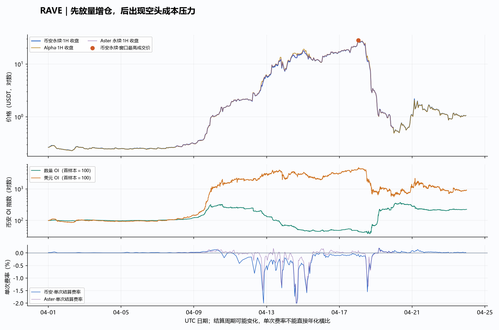
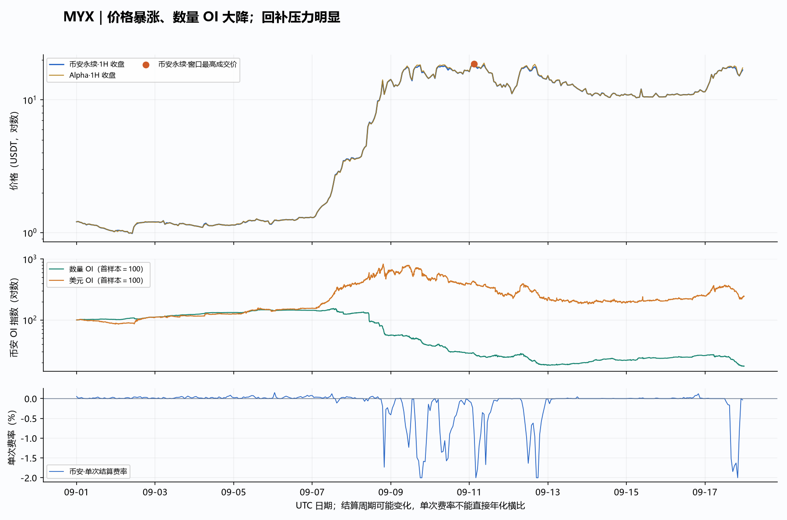
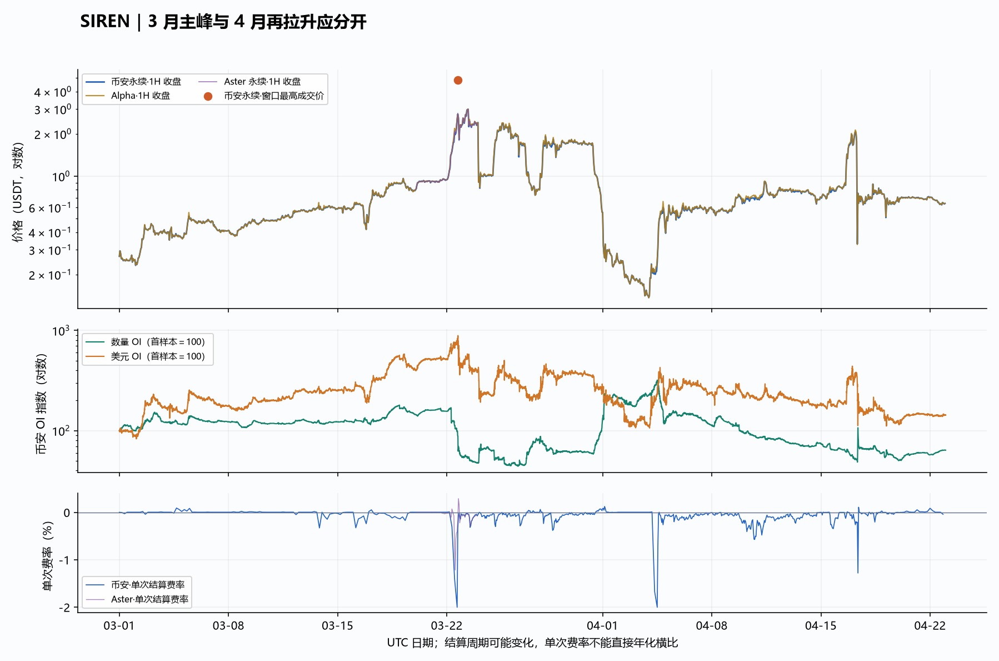
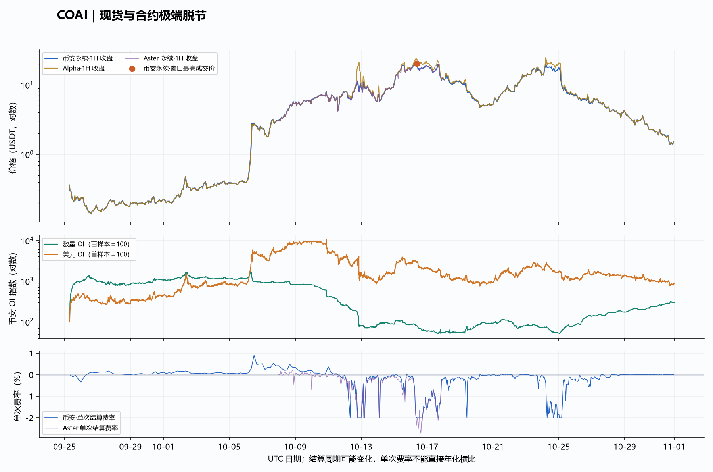
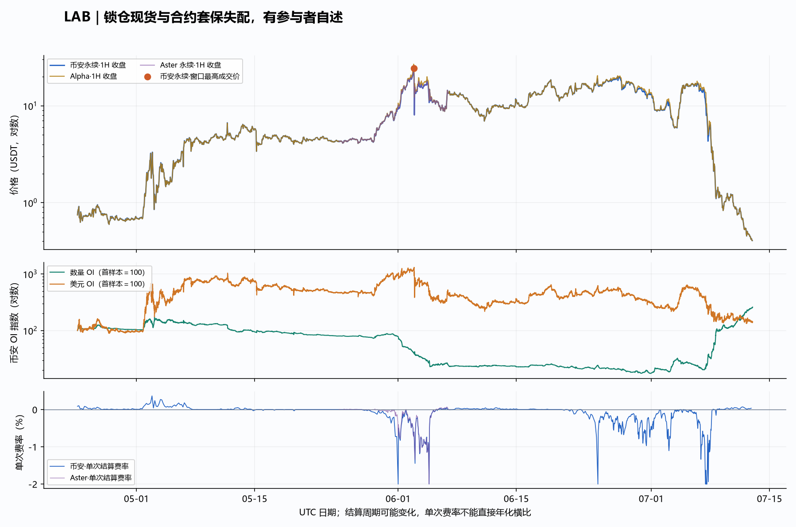
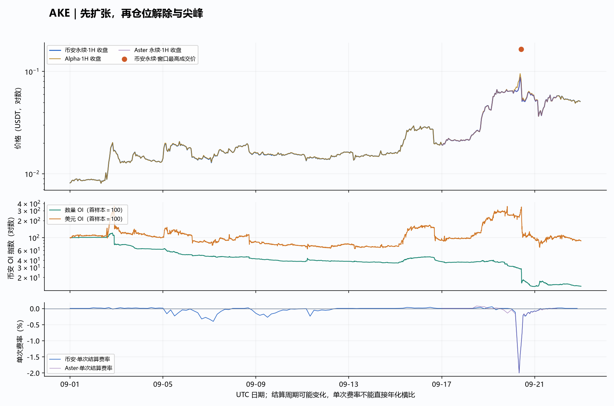
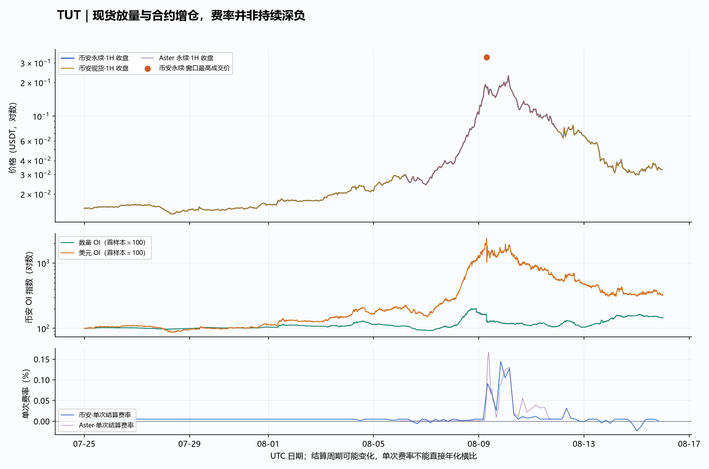
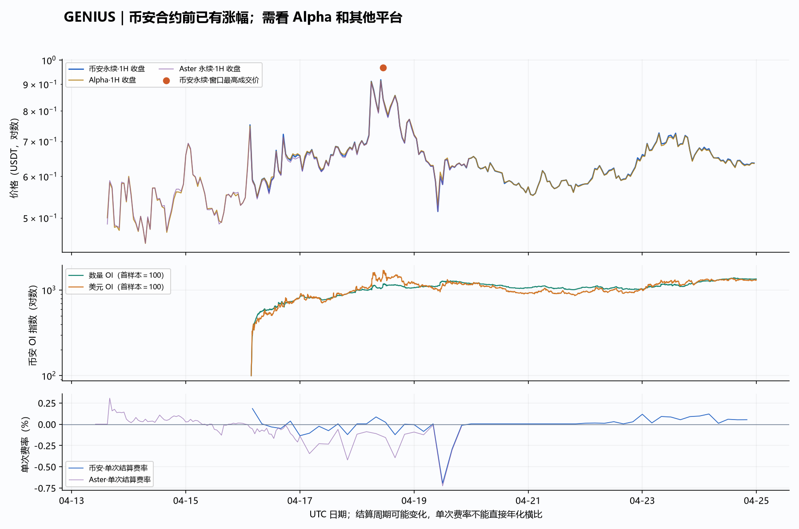
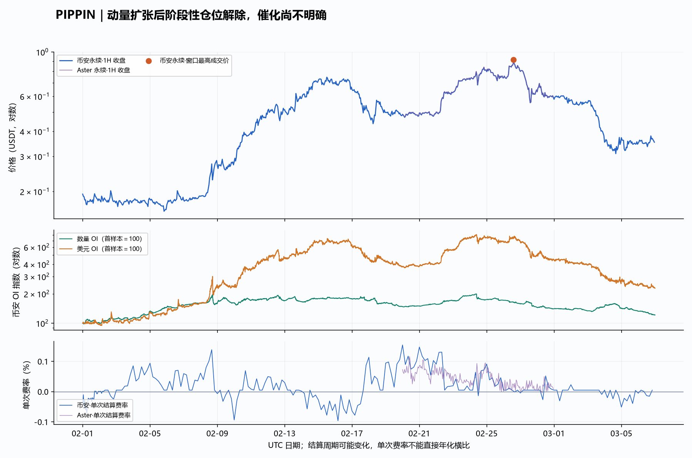

# 妖币历史复盘：9 个明确币种与跨平台数据核查

研究日期：2026-09-23。来自用户截图的公开数据复盘，无交易操作。所有表格、图表统一 UTC，北京时间加 8 小时。

## 先给结论

**这些行情存在不同路径，不能统一解释成“高 OI＋深负费率＝庄家要拉百倍”。** RAVE 先增仓启动、后成本挤压；MYX、LAB、COAI 的加速段呈现明显回补／套保持有成本压力；TUT 则有现货放量和前期增仓，费率整体偏正。PIPPIN 的具体启动催化仍缺可靠证据。

价格上涨时，美元 OI 可能增加，而真实持仓数量却下降。MYX 在 2025-09-08 数量 OI −55.95%、美元 OI +71.82%，就是典型。必须同时保存数量、名义金额、价格和场所。

跨平台监测非常必要，但本次证据不支持“这些币全部在 Aster／Hyperliquid 被操盘”。已取得 Aster 上 8 个案例同期 K 线和费率；LAB 还有当事方在 Aster、Aden 套保的原始自述。尚无完整跨场所历史 OI、逐笔强平和账户关联，不能精确分摊每个平台推动涨幅的贡献。

## 截图需要修正的口径

| 对象 | 核查结果 |
|---|---|
| MYX | 截图本身写 2025.9，应作为去年案例。 |
| COAI | 大行情在 2025.9–10；未确认 2026.4 有相同百倍主升。 |
| SIREN | 2026-03-22 是币安合约年内主峰，4 月另有再拉升。 |
| GENIUS | Alpha 与币安合约上线时间不同，不能用后者解释全部早期涨幅。 |
| AKE | 所查币安 9 月 1H 及两段异常小时 1m，未复现“一根针 16 倍”；清算金额也未核实。 |
| 龙虾 | 缺少代码／合约地址，暂不猜测代入。 |

## 数据与计算口径

取得 **7,118 根币安合约 1H K 线、85,404 个 5 分钟 OI／多空比样本**，覆盖 9 币事件窗口；另有 7 币 Alpha 历史价格、TUT 币安现货、8 币 Aster 数据。本次原生行情接口免费公开，未用付费清算服务。

旧 OI 来自币安官方 data.binance.vision 日归档，突破了近月 REST 查询窗口限制。归档 CSV 不总是按时间排列，计算前已排序。日内 OI 通常取 00:00 与 23:55；新币首日取实际首样本。它与日 K 开收盘不完全同步，不作逐秒资金归因。

美元 OI 使用交易所原生 sum_open_interest_value，数量 OI 使用 sum_open_interest；只比较同币同合约数量，不能跨币相加。费率“日累加”是实际结算费率之和，表示恒定名义本金的成本指数，不是固定币数仓位的实际亏损；表中同时给出次数。负费率通常为空头向多头付费。

图中展示单次结算费率，各平台或时期周期可变，不可直接横向年化比较。OI 曲线首样本＝100，显示数量与金额分歧，不是资金流入或收益率。所有峰值倍数均为事后统计，不代表能以首价买到、最高价卖出，也未扣费率和滑点。

## 逐币复盘

### RAVE｜先放量增仓，后出现空头成本压力

币安合约窗口：2026-04-01 至 2026-04-24（终点不含）。首根开盘 0.26124，最高 28.3，峰值所在小时 2026-04-18 01:00 UTC；最高／首价 **108.33 倍**。

Alpha 对照：首价 0.2648，最高 28.4（2026-04-18 01:00 UTC），最高／首价 107.25 倍。两市场最高值不一定同时出现。

4 月 9 日，币安合约从 0.31614 收到 0.99763，日涨 215.57%；数量 OI 增加 125.46%，成交额从前一天的 1,021 万增至 4.70 亿 USDT。当天结算费率仍为正。先发生的是价量与持仓扩张，不能用后来出现的极端负费率解释最初启动。

4 月 12 日，价格再涨 175.23%，数量 OI 减少 43.50%，单次费率最低达到 −2%。4 月 17 日，数量 OI 几乎不变（−0.11%），美元 OI 却从 9,421 万升至 1.218 亿，这并不等于有同等规模的新仓。

4 月 18 日合约最高 28.3，当日收盘 2.92572，次日收至 0.638。深负费率没有阻止随后崩跌，不能把它作为单独做多条件。

[CoinDesk 当时报道](https://www.coindesk.com/business/2026/04/18/binance-and-biget-to-probe-rave-s-4-500-token-surge-as-claims-of-insider-orchestrated-rally-grow)记载了筹码集中、异常转账的指控以及 Binance、Bitget 调查，也载明项目方否认参与价格行为。本次没有独立重放相关地址。

**机制判断：** 先增仓放量，后仓位解除与空头持有成本加剧。供给集中可能放大行情，但“哪个实体操纵了多少涨幅”未证实。

| UTC 日期 | 合约开→收 / 日内高点 | 数量 OI 变化 | 美元 OI 起→末（百万） | 日费率和 / 次数 |
|---|---|---:|---:|---:|
| 2026-04-08 | 0.26708→0.31593 / 0.32497 | +15.50% | 3.25→4.41 | +0.0853% / 6 |
| 2026-04-09 | 0.31614→0.99763 / 1.12928 | +125.46% | 4.38→31.47 | +0.2554% / 6 |
| 2026-04-12 | 2.16937→5.97078 / 6.25785 | -43.50% | 57.78→91.74 | -5.8519% / 9 |
| 2026-04-15 | 15.80032→10.8906 / 18.56623 | -3.98% | 89.74→59.43 | -10.8672% / 24 |
| 2026-04-17 | 16.99124→21.9445 / 22.66 | -0.11% | 94.21→121.81 | -1.9185% / 24 |
| 2026-04-18 | 21.94325→2.92572 / 28.3 | +48.29% | 122.50→24.10 | -7.1912% / 24 |
| 2026-04-19 | 2.92603→0.638 / 3.115 | +289.75% | 25.06→20.63 | +1.2717% / 24 |

### MYX｜价格暴涨、数量 OI 大降；回补压力明显

币安合约窗口：2025-09-01 至 2025-09-18（终点不含）。首根开盘 1.2069，最高 18.65，峰值所在小时 2025-09-11 03:00 UTC；最高／首价 **15.45 倍**。

Alpha 对照：首价 1.20498，最高 19（2025-09-12 17:00 UTC），最高／首价 15.77 倍。两市场最高值不一定同时出现。

这是 **2025 年 9 月** 的对照案例。9 月 7 日已从 1.3075 收到 3.488，当天累计结算费率仍为正。

9 月 8 日，从 3.4895 收到 13.8888，日涨 298.02%。数量 OI 从 3,311.996 万降至 1,459.066 万（−55.95%）；美元 OI 却从 1.182 亿增至 2.031 亿（+71.82%）。因此“美元 OI 上涨＝大量新增空头”在这里会严重误判。

9 月 9 日按每小时实际结算记录累加的费率为 −16.6806%。固定名义本金的空头持续承受显著成本。币安合约窗口最高 18.65，Alpha 最高 19.00，日期也不同。

[Bubblemaps 9 月 11 日原帖](https://x.com/bubblemaps/status/1966158091034165408)提出 100 个新钱包领取约 980 万枚 MYX、资金路径与创建者有关的分析。这是研究方归因，本次未独立验证链上关联；按高价计算的代币价值不等于实际流入资金。

**机制判断：** 加速段符合明显的仓位解除与空头回补压力。OI 下降本身无法区分主动平空、强平、双边平仓和对冲调整。截图“累计爆空 8,950 万美元”尚未取得完整清算明细，暂不确认为事实。

| UTC 日期 | 合约开→收 / 日内高点 | 数量 OI 变化 | 美元 OI 起→末（百万） | 日费率和 / 次数 |
|---|---|---:|---:|---:|
| 2025-09-05 | 1.1433→1.1562 / 1.3024 | +9.23% | 39.16→43.39 | +0.5969% / 24 |
| 2025-09-07 | 1.3075→3.488 / 3.73 | -11.12% | 48.84→115.23 | +0.6040% / 24 |
| 2025-09-08 | 3.4895→13.8888 / 14.489 | -55.95% | 118.18→203.06 | -2.6778% / 24 |
| 2025-09-09 | 13.883→14.478 / 18.58 | -31.05% | 206.02→146.13 | -16.6806% / 24 |
| 2025-09-11 | 16.602→13.272 / 18.65 | -13.05% | 123.64→85.13 | -11.2275% / 24 |
| 2025-09-12 | 13.269→14.302 / 17.944 | -26.14% | 81.29→67.01 | -13.0757% / 24 |

### SIREN｜3 月主峰与 4 月再拉升应分开

币安合约窗口：2026-03-01 至 2026-04-23（终点不含）。首根开盘 0.2873，最高 4.81065，峰值所在小时 2026-03-22 17:00 UTC；最高／首价 **16.74 倍**。

Alpha 对照：首价 0.28623，最高 4.2（2026-03-22 17:00 UTC），最高／首价 14.67 倍。两市场最高值不一定同时出现。

年内币安合约主峰在 **3 月 22 日**。3 月 20–21 日结算费率仍为每次 +0.005%。3 月 22 日由 0.94337 开盘，一度冲至 4.81065，收于 2.31119。

当日数量 OI 减少 65.24%。下降并非全在冲顶之后：00:00 为 4,857 万枚，到峰值所在小时开始的 17:00 已降至 2,748 万枚。当天结算从 4 小时转为 1 小时，最低单次 −2%。

[Bubblemaps 原帖](https://x.com/bubblemaps/status/2036116339954503725)披露持有约 47%–50% 供应的关联钱包簇，并明确实际身份仍未知。原帖页面显示 3 月 23 日，晚于本次价格主峰；**不能把这篇事后公开调查回填成起涨前已可用的预警输入**。

4 月 4 日另有从 0.13694 收至 0.50477 的 +268.61% 行情，数量 OI 同日下降 47.81%。截图把它放在 4 月有行情依据，但遗漏了更早主峰。

**机制判断：** 多轮供给集中线索，叠加加速段仓位解除与高额空头成本；不能只用某个 4H 突破解释整个周期。

| UTC 日期 | 合约开→收 / 日内高点 | 数量 OI 变化 | 美元 OI 起→末（百万） | 日费率和 / 次数 |
|---|---|---:|---:|---:|
| 2026-03-20 | 0.78822→0.89862 / 0.9756 | +10.21% | 35.51→44.74 | +0.0300% / 6 |
| 2026-03-21 | 0.89863→0.94342 / 1.06 | -2.37% | 45.16→45.91 | +0.0300% / 6 |
| 2026-03-22 | 0.94337→2.31119 / 4.81065 | -65.24% | 45.89→38.99 | -4.4247% / 12 |
| 2026-03-23 | 2.31132→2.37313 / 3.14605 | -12.42% | 39.59→35.36 | -2.1116% / 24 |
| 2026-04-04 | 0.13694→0.50477 / 0.77763 | -47.81% | 9.74→18.68 | -5.5289% / 15 |
| 2026-04-10 | 0.63842→0.68565 / 0.72678 | -11.62% | 18.84→18.11 | -7.2810% / 24 |

### COAI｜现货与合约极端脱节

币安合约窗口：2025-09-25 至 2025-11-01（终点不含）。首根开盘 0.4938，最高 20.099，峰值所在小时 2025-10-16 09:00 UTC；最高／首价 **40.70 倍**。

Alpha 对照：首价 0.326504，最高 46.127988（2025-10-12 20:00 UTC），最高／首价 141.28 倍。两市场最高值不一定同时出现。

大行情发生在 **2025 年 9–10 月**。2026 年日线扫描未复现截图所暗示的 4 月百倍主升行情。

10 月 12 日 20:00–20:59 UTC，同一小时 Alpha 最高价为 46.127988，币安合约指数最高 45.217918，币安合约成交最高仅 16.528。这些是各自小时最高值，不表示同一秒发生。小时收盘分别约 Alpha 19.0618、指数 16.6878、合约 9.175，仍显示明显分歧。

10 月 16 日币安按小时结算，全天 24 次费率之和为 −32.0539%；合约与指数的小时收盘价差中位数约 −12.27%。不同市场的最高价不可以相减后当作可实现套利收益。

窗口内 Alpha 从首根开盘约 0.3265 到最高 46.128，约 141.3 倍；币安合约从 0.4938 到最高 20.099，约 40.7 倍。**“百倍”与“四十倍”可以同时成立，因为市场和时间口径不同。**

**机制判断：** 现货／指数与合约脱节，持续制造空头持有成本，是可观测放大机制。自由流通供给受限、借币不足、套利障碍和集中控制各占多少，需要当时地址、借贷及盘口证据，不能仅凭折价定性操纵。

| UTC 日期 | 合约开→收 / 日内高点 | 数量 OI 变化 | 美元 OI 起→末（百万） | 日费率和 / 次数 |
|---|---|---:|---:|---:|
| 2025-10-09 | 5.36917→5.30277 / 6.89281 | -2.38% | 212.64→200.80 | +1.2166% / 6 |
| 2025-10-10 | 5.30668→6.683 / 11.51871 | -48.80% | 211.66→129.99 | +0.4538% / 6 |
| 2025-10-12 | 7.78→10.613 / 16.528 | -67.99% | 94.37→41.02 | -18.6237% / 18 |
| 2025-10-15 | 9.128→16.543 / 19.78 | -3.46% | 38.70→67.65 | -4.5550% / 24 |
| 2025-10-16 | 16.542→19.082 / 20.099 | -31.13% | 64.38→53.58 | -32.0539% / 24 |
| 2025-10-17 | 19.085→12.449 / 19.74 | -7.36% | 52.62→32.29 | -27.0078% / 24 |

### LAB｜锁仓现货与合约套保失配，有参与者自述

币安合约窗口：2026-04-24 至 2026-07-13（终点不含）。首根开盘 0.7327，最高 24.3998，峰值所在小时 2026-06-02 21:00 UTC；最高／首价 **33.30 倍**。

Alpha 对照：首价 0.730199，最高 27.5（2026-06-02 21:00 UTC），最高／首价 37.66 倍。两市场最高值不一定同时出现。

[PiggyBank 6 月 10 日原始报告](https://x.com/piggybank_fi/status/2064780172310589669)称，5 月经 OTC 买入 142,857.14 枚锁仓 LAB，并在 **Aster、Aden** 开空做部分套保。后来深负费率令维持套保成本难以承受，于约 9 美元平空，空头实现损失约 47.64 万美元；锁仓现货无法立即出售。本次未独立核验其全部地址与成交。

币安数据与持续成本压力相符：6 月 1 日价格从 9.3532 收至 15.6493，数量 OI 减少 35.15%；6 月 1–4 日实际结算费率逐日累加约 −9.68%、−9.91%、−16.96%、−18.70%。Aster 同期原生记录也出现每小时单次 −2%。

窗口内 Alpha 最高 27.50、币安合约最高 24.3998。PiggyBank 所说的约 27 美元可与现货对照，不能因不同场所价格差异直接判其错误。

**机制判断：** “未到爆仓线，也会因费用退出”有当事方自述支持。跨平台对冲、现货不可流动、抵押资金约束令理论套利难以收敛。但这不证明操盘者就是 Aster 某账户，更不是指认 Hyperliquid 的证据。

| UTC 日期 | 合约开→收 / 日内高点 | 数量 OI 变化 | 美元 OI 起→末（百万） | 日费率和 / 次数 |
|---|---|---:|---:|---:|
| 2026-05-28 | 4.4706→4.3744 / 4.7394 | -4.52% | 60.85→56.84 | -0.1362% / 6 |
| 2026-06-01 | 9.3532→15.6493 / 16.6697 | -35.15% | 125.12→138.62 | -9.6787% / 24 |
| 2026-06-02 | 15.6509→15.4302 / 24.3998 | -24.51% | 139.57→103.68 | -9.9053% / 24 |
| 2026-06-03 | 15.4173→15.3623 / 18.2648 | -14.59% | 95.77→87.14 | -16.9633% / 24 |
| 2026-06-04 | 15.3623→12.05 / 18.18 | -26.24% | 85.85→50.34 | -18.6992% / 24 |
| 2026-06-06 | 9.692→13.425 / 15.699 | -4.85% | 42.82→56.32 | +0.5128% / 24 |

### AKE｜先扩张，再仓位解除与尖峰

币安合约窗口：2026-09-01 至 2026-09-23（终点不含）。首根开盘 0.008114，最高 0.164696，峰值所在小时 2026-09-20 10:00 UTC；最高／首价 **20.30 倍**。

Alpha 对照：首价 0.008111，最高 0.157812（2026-09-20 10:00 UTC），最高／首价 19.46 倍。两市场最高值不一定同时出现。

9 月 18 日币安合约从 0.021288 收至 0.046385，日涨 117.89%；数量 OI 仅增 4.00%，美元 OI 却增 123.74%。9 月 19 日继续上涨，数量 OI 下降 18.95%。

9 月 20 日 10:31 UTC 的 1 分钟内，币安成交最高 0.164696、标记价最高 0.15739533、指数最高 0.15719135。因此不只是成交价尖峰，标记价和指数也在上行。数量 OI 当天 00:00 为 10.632 亿枚，10:30 已降至 5.540 亿枚，23:55 为 4.709 亿枚。

当日最低单次费率 −2%，全天费率和 −7.2736%，日线最终收跌约 9.25%。Aster 同日最高成交价为 0.16。哪个平台先引发拉升，仍需更细的跨平台逐笔成交和盘口。

**截图校验：** 9 月币安最大“1H 最高价÷开盘价”为 2.229 倍（9 月 2 日）；9 月 20 日峰值小时为 1.877 倍。对这两个异常小时补拉 1m 成交、标记价和指数，未复现“一根针 16 倍”。这不否定其他交易所或周期，但该说法及爆空 2,700 万／3,000 万以上目前均未核实。

**机制判断：** 后段存在仓位解除和空头成本压力；启动消息、供给控制和平台主导关系仍未确认。

| UTC 日期 | 合约开→收 / 日内高点 | 数量 OI 变化 | 美元 OI 起→末（百万） | 日费率和 / 次数 |
|---|---|---:|---:|---:|
| 2026-09-02 | 0.008744→0.016551 / 0.044859 | -25.17% | 30.28→42.61 | +0.0788% / 6 |
| 2026-09-18 | 0.021288→0.046385 / 0.047839 | +4.00% | 27.05→60.53 | +0.0750% / 6 |
| 2026-09-19 | 0.046394→0.064543 / 0.0885 | -18.95% | 60.84→68.54 | +0.0674% / 6 |
| 2026-09-20 | 0.064542→0.058571 / 0.164696 | -55.71% | 69.04→27.56 | -7.2736% / 18 |
| 2026-09-21 | 0.058537→0.057786 / 0.060968 | +7.31% | 27.02→29.22 | -0.3886% / 21 |
| 2026-09-22 | 0.057788→0.050941 / 0.0642 | -5.95% | 29.21→24.18 | +0.0580% / 6 |

### TUT｜现货放量与合约增仓，费率并非持续深负

币安合约窗口：2026-07-25 至 2026-08-16（终点不含）。首根开盘 0.01478，最高 0.33733，峰值所在小时 2026-08-09 07:00 UTC；最高／首价 **22.82 倍**。

8 月 7 日合约开盘 0.02449，8 月 9 日最高 0.33733，从该起点至峰值约 13.77 倍；8 月 10 日已回落至 0.10779 收盘。

这里取得了真正的 Binance Spot 同期 K 线。8 月 7、8、9 日现货成交额分别约 1,153 万、7,339 万、2.661 亿 USDT；主动买入成交额占比分别约 55.36%、52.12%、51.70%。这不是净资金流入。

8 月 8 日数量 OI 增加 62.97%，价格上涨 179.95%，支持参与及持仓规模共同扩张。8 月 9 日冲顶时数量 OI 转为下降。但 8 月 7–9 日费率逐日累加约 +0.0095%、+0.0203%、+0.3364%，并无持续深负。Aster 同期也未显示与 LAB 相当的极端负值。

**机制判断：** 现货与合约共同扩张，随后仓位解除。深负费率不是所有大行情的必备条件；正费率也不排除局部回补，放量本身同样不能证明买盘来自分散的自然需求。

| UTC 日期 | 合约开→收 / 日内高点 | 数量 OI 变化 | 美元 OI 起→末（百万） | 日费率和 / 次数 |
|---|---|---:|---:|---:|
| 2026-08-06 | 0.02866→0.0245 / 0.03133 | -14.00% | 8.01→5.83 | +0.0121% / 6 |
| 2026-08-07 | 0.02449→0.03895 / 0.04047 | +13.69% | 5.82→10.54 | +0.0095% / 6 |
| 2026-08-08 | 0.03896→0.10907 / 0.11734 | +62.97% | 10.69→48.36 | +0.0203% / 6 |
| 2026-08-09 | 0.1091→0.20192 / 0.33733 | -30.87% | 49.03→62.02 | +0.3364% / 6 |
| 2026-08-10 | 0.20191→0.10779 / 0.25 | -7.29% | 63.67→30.64 | +0.2719% / 6 |
| 2026-08-11 | 0.1078→0.07653 / 0.12148 | -3.47% | 30.71→20.93 | +0.0415% / 6 |

### GENIUS｜币安合约前已有涨幅；需看 Alpha 和其他平台

币安合约窗口：2026-04-13 至 2026-04-25（终点不含）。首根开盘 0.62，最高 0.9672，峰值所在小时 2026-04-18 11:00 UTC；最高／首价 **1.56 倍**。

Alpha 对照：首价 0.2，最高 0.96（2026-04-18 06:00 UTC），最高／首价 4.80 倍。两市场最高值不一定同时出现。

Alpha 本次返回的首根 K 线为 4 月 13 日 15:00 UTC，开盘 0.20；币安合约于 4 月 16 日 03:00 UTC 才出现首根 K 线，首价 0.62。在币安合约上线前 Alpha 已一度达到 0.836。

Alpha 的公告报道预定开盘为 11:00 UTC，但接口首根是 15:00；此前 4 小时有覆盖不确定性，不能把 0.20 说成全市场最早成交价。Alpha 本窗口最高 0.96；币安合约最高 0.9672，约为其首价的 1.56 倍。

Aster 同期数据已从 4 月 13 日覆盖，说明“币安尚未上合约”并不等于“市场完全没有合约”。

**机制判断：** 新币上市、Alpha 分发提供了可核查的重估背景，但无法判定各类买盘贡献。不能用币安合约上线后的 OI 解释前面全部涨幅，更不能把这个窗口列为币安合约百倍轧空样本。

| UTC 日期 | 合约开→收 / 日内高点 | 数量 OI 变化 | 美元 OI 起→末（百万） | 日费率和 / 次数 |
|---|---|---:|---:|---:|
| 2026-04-16 | 0.62→0.6595 / 0.7985 | +725.08% | 0.56→4.71 | +0.1468% / 5 |
| 2026-04-17 | 0.6597→0.6975 / 0.7264 | +20.17% | 4.78→6.00 | -0.4542% / 6 |
| 2026-04-18 | 0.6975→0.7427 / 0.9672 | +7.23% | 5.70→6.82 | -0.0022% / 6 |
| 2026-04-19 | 0.7427→0.6484 / 0.7485 | +11.19% | 6.84→6.64 | -1.0792% / 6 |

### PIPPIN｜动量扩张后阶段性仓位解除，催化尚不明确

币安合约窗口：2026-02-01 至 2026-03-07（终点不含）。首根开盘 0.18853，最高 0.9162，峰值所在小时 2026-02-26 14:00 UTC；最高／首价 **4.86 倍**。

本次复盘 2026 年 2 月这轮，币安合约在 2 月 26 日达到 0.9162。按 2 月 1 日首根开盘至峰值约 4.86 倍，只代表本窗口，不是上市以来总涨幅。

2 月 23 日价格涨 18.37%，数量 OI 增加 13.51%；2 月 26 日冲高时数量 OI 减少 8.13%。2 月 23–26 日每日累计费率均为正，没有 MYX／LAB 的持续深负结构。

二手文章把上涨归因于 AI 叙事、鲸鱼积累，但本次读到的部分正文混入 Pudgy Penguins 和不一致价格区间，未采纳其中“控盘比例”“净流入”等数据。尚无关键钱包的历史快照。

**机制判断：** 可确认动量与持仓扩张后阶段性解除；具体启动事件和供给控制关系仍缺证据，不硬贴“庄家吸筹／轧空”标签。

| UTC 日期 | 合约开→收 / 日内高点 | 数量 OI 变化 | 美元 OI 起→末（百万） | 日费率和 / 次数 |
|---|---|---:|---:|---:|
| 2026-02-07 | 0.18709→0.18982 / 0.1905 | +5.10% | 17.99→19.33 | +0.1984% / 6 |
| 2026-02-14 | 0.58501→0.70548 / 0.7395 | +7.75% | 62.80→80.44 | -0.0859% / 6 |
| 2026-02-23 | 0.6247→0.73944 / 0.74955 | +13.51% | 67.63→91.11 | +0.0948% / 6 |
| 2026-02-24 | 0.73943→0.81198 / 0.888 | -9.37% | 90.41→90.33 | +0.2009% / 6 |
| 2026-02-26 | 0.74165→0.80943 / 0.9162 | -8.13% | 81.22→81.17 | +0.0305% / 6 |
| 2026-03-02 | 0.57083→0.55442 / 0.58549 | -2.79% | 50.31→47.25 | +0.0479% / 6 |

## 跨平台核查：币安规则、Aster 与 Hyperliquid

币安官方 [Market Maker Red Flags and Guidelines for Crypto Projects and Users](https://www.binance.com/en/blog/education/3378047125698186214) 页面显示日期 2026-03-25。本次在浏览器读到的原文包括：项目不得与做市商／第三方协调操纵价格、扭曲流动性；禁止造成过度下行压力的大规模倾销；禁止与做市商的利润分享和保收益模式。其描述的是具体失序行为，不能简化为“禁止所有主动做市”或“币安上的币不会暴涨暴跌”。

这些规则为“行为可能跨平台转移”提供研究动机，但不能单独证明哪个币在哪个平台被操纵。即使某个平台主导成交，也需区别正常投机、套保、套利和集中账户异常行为。现货指数变化还可能传导到多个平台的标记价和清算条件，不一定只在拉价成交所在场所造成损失。

本次 Aster 已直接调用官方公共 <code>/fapi/v3/klines</code> 和 <code>/fapi/v3/fundingRate</code>，取得 8 个币的同期记录，见下表。尚未取得这些窗口的完整 Aster 历史 OI。实时 OI 或当前市场列表不能回填成过去的 OI。

| 币 | Aster 实际 K 线范围（UTC） | 1H 根数 | 最高成交价 | 最低单次费率 |
|---|---|---:|---:|---:|
| RAVE | 2026-04-08 00:00～2026-04-19 23:00 | 288 | 28.94 | -2.0000% |
| SIREN | 2026-03-20 00:00～2026-03-23 23:00 | 96 | 5.11902 | -1.2142% |
| COAI | 2025-10-08 00:00～2025-10-17 23:00 | 240 | 21.99 | -2.7354% |
| LAB | 2026-05-25 00:00～2026-06-06 23:00 | 312 | 24.31775 | -2.0000% |
| AKE | 2026-09-17 00:00～2026-09-21 23:00 | 120 | 0.16 | -2.0000% |
| TUT | 2026-08-06 04:00～2026-08-11 23:00 | 140 | 0.32598 | -0.0011% |
| GENIUS | 2026-04-13 15:00～2026-04-19 23:00 | 153 | 0.9555 | -0.7254% |
| PIPPIN | 2026-02-20 00:00～2026-02-28 23:00 | 216 | 0.9292 | -0.0044% |

Aster 当前元数据中 MYX 的上线日期落在 2026 年，因此没有把当前数据套进 2025 年 9 月案例；这也不能单独证明其过去所有版本都没有对应交易。Aster 对照窗口比完整币安窗口短，表内最高值不一定是该平台全历史最高值。

Hyperliquid 已实际调用公开 <code>POST /info</code> 的 <code>allPerpMetas</code>，返回原生及 builder 市场共 11 组元数据；当前没有匹配到上述 9 个准确币种代码。这个结果只说明本次清单，**不证明历史从未存在，也不说明不值得接入**。后续按实际市场 ID、builder DEX、挂牌时间决定覆盖；尤其不能把 HYPE 代币的 OI，错当作 Hyperliquid 平台内全部代币的 OI。

## CMC 能否汇总同一币种的全市场合约

**能力层面可以作为候选，而且 2026 年官方新文档明确列出 Free 套餐支持。** [官方更新日志](https://coinmarketcap.com/api/documentation/changelog)在 2026-06-04 项下新增了以下接口；[衍生品 API 文档](https://coinmarketcap.com/api/documentation/pro-api-reference/derivatives)已逐项核对。

| 接口 | 用途 |
|---|---|
| <code>/v5/cryptocurrency/derivatives/market-pairs/list/latest</code> | 同一代币跨交易所的永续／交割合约交易对，含 OI、资金费率、指数价格、价差。支持 <code>center_type=all/cex/dex</code>，这是本产品最相关的接口。 |
| <code>/v5/exchange/derivatives/market-pairs/list/latest</code> | 查询单一交易所的全部合约，可以按平台批量采集再本地按币种归并。 |
| <code>/v5/exchange/derivatives/list</code> | 交易所整体 OI、成交额等，不是某代币全市场 OI。 |

官方文档写明约每 60 秒更新；每返回 250 个交易对／交易所消耗 1 credit，向上取整，额外换算货币另计。最新 [定价页](https://coinmarketcap.com/api/pricing/)列出免费 Basic 为 **15,000 credits／月、50 requests／分钟**。

本次没有使用用户的 API Key。实测对应 <code>/public-api</code> 无 Key 路径返回 HTTP 403、错误码 1005、“An API Key is required for this call.”。因此结论是 **文档支持免费套餐，需要免费 Key；不是已验证无 Key 可调用**。

**实际覆盖尚未确认。** 接口返回 CMC 已跟踪的活跃市场，不是数学意义上的全部交易所。须使用免费 Key 实测 RAVE、LAB 等，核对是否包含 Aster／Hyperliquid、该币是否已挂牌、OI 非空率、更新时效、单位。示例 JSON 不是真实覆盖证明。当前这组接口是 <code>latest</code>，不能据此假定同样提供历史 OI。

免费预算也需要设计：每币每次最低 1 credit 时，100 币每 5 分钟逐币刷新，30 天约需 864,000 credits。另一种预算情景是 3 个平台、各 500 合约、每次各 2 credits、每 30 分钟采一次，30 天约 8,640 credits；这只是测算，实际返回条数、分页和覆盖仍须验证。告警需要的秒级／分钟级变化，宜由免费原生 API／WebSocket 补充并自行保存历史。

下一轮优先验证：**CMC 做低频市场映射与聚合校验，原生平台接口做实时行情和关键异常追踪，币安官方归档补过去 OI**。拿到真实 CMC 样本并核对覆盖后，再确定它是主数据源还是辅助源。

## 信号产品应从这些案例学到什么

| 可验证状态 | 需要同时看到什么 | 不能直接推出什么 |
|---|---|---|
| 现货与持仓扩张 | 现货放量、价格结构突破、数量 OI 增长，分平台显示变化 | 新增 OI 不能直接分成新增多头或空头，账户多空比也不是金额比。 |
| 空头持有成本升高 | 结算周期、持续负费率、合约折价；有条件时关联锁仓／借币约束 | 深负费率可能对应下跌预期或套利约束，不能独立触发做多。 |
| 上行中仓位解除 | 上涨同时数量 OI 下降；有逐笔强平时另列真实空头强平额 | 不把全部 OI 下降当爆空，不把美元 OI 上升当资金流入。 |
| 跨平台分歧 | 现货、成交价、指数价、标记价、费率、OI 时间对齐 | 一个场所先出高价不能直接证明它是操盘场所。 |
| 高位失速／结构转弱 | 明确周期与结构名称，收盘跌回确认箱体／关键低点，承接和持仓变化 | 负费率未结束也可能崩盘，“空头还在”不能保证继续上涨。 |

总 OI 应标为“**已覆盖市场 OI**”，附覆盖平台数、缺失平台、更新时间。统一 USD 名义金额，永续与交割分列；处理合约乘数、保证金类型、数量单位。同一合约通常不把多空两边重复计两遍，聚合供应商与原生数据也不可重复相加。计算变化要使用同一批可比市场，防止新增覆盖造成伪增仓。

OI／流通市值比仍可研究，但本次没有可信的当时自由流通供应快照，未把今天市值倒推过去，也未设“超过某比例必然轧空”的阈值。名义流通量、可卖筹码、可借筹码和盘口深度不是一回事。

**关于“最大痛点／涨幅终点”：** 本次数据不能给出唯一价格。CEX 看不到所有账户的入场、杠杆、跨仓抵押和补保证金；链上即使可观察部分仓位，清算价也会随费用和抵押变化。LAB 还说明未到清算线也可能因成本先平仓。更可行的是动态跟踪“已观察到的清算敏感区、持仓成本、现货承接、多周期趋势和失效条件”。4H 阻力只是局部观察区，不能当整个趋势的涨幅上限。

这是事后挑选的暴涨样本，有明显幸存者偏差。验证信号还必须纳入同日未暴涨、失败突破、高 OI 却下跌的对照币，使用当时可得数据滚动计算，计入手续费、费率、滑点、延迟和失效规则。本报告不是策略胜率回测。

## 数据来源、局限和复现

币安 316 个原始 ZIP 通过所附 SHA256 校验。9 币事件窗口的 1H／5m 序列未发现重复时间或内部缺口（不代表上市前和全市场覆盖完整）。RAVE、MYX、COAI、SIREN 各抽查一天，共 96 根 1H OHLCV 与官方日归档一致。8 币共 3,387 条结算费率与月归档逐条一致；AKE 9 月尚未纳入月归档交叉检查，以 REST 为准。

- [质量检查](quality_checks.json)、[请求 URL／时间／哈希](manifest.json)、[CMC／Hyperliquid 实测记录](platform_probes.json)。
- 每币 <code>*_event.json</code> 保存币安 K 线、指数、费率；<code>*_metrics_5m.csv</code> 是归档行，<code>*_daily_analysis.csv</code> 是按时间排序后计算的日汇总。
- <code>*_alpha.json</code>、<code>*_aster.json</code> 保存其他市场；<code>alpha_identity.json</code> 保存当前 Alpha 名称、链、合约地址映射。当前映射不能证明历史筹码控制关系。
- <code>raw/</code> 保留原始响应、ZIP 和 CHECKSUM；<code>sources/</code> 保留已下载资料和状态。403／空响应未作为已读正文，疑似混淆对象的文章没有采纳其具体数值。
- [Binance 官方历史数据](https://github.com/binance/binance-public-data)、[Aster 官方 API 仓库](https://github.com/asterdex/api-docs)、[Hyperliquid Info API](https://hyperliquid.gitbook.io/hyperliquid-docs/for-developers/api/info-endpoint)。
- 尚缺全市场历史 OI、完整清算流水、历史盘口、逐地址历史供给控制快照。原生数据、参与者自述、第三方调查和机制推断在正文分别标明。

复现脚本副本在 <code>scripts/</code>，本次原始运行目录为当前工作区 <code>work/</code>。采集顺序：replay_2026.py（discovery，再 collect）、replay_extra.py、replay_alpha.py、analyze_replays.py、replay_aster.py、replay_validate.py、build_replay_report.py。采集脚本 ROOT 默认为其上一级目录下的 outputs/妖币历史复盘_2026-09-23；从副本执行前需修改 ROOT。图表依赖 matplotlib，HTML 依赖 markdown，均未包含 API Key。
